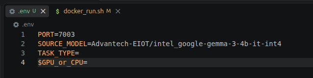
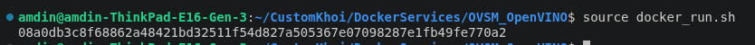

# OpenVINO Docker Service Quickstart Guide

This guide provides instructions on how to set up and run the OpenVINO Model Server using Docker. For detailed documentation, refer to the official OpenVINO Model Server documentation: [OpenVINO Model Server Docs](https://docs.openvino.ai/2025/model-server/ovms_docs_llm_quickstart.html).

## Source Models

- **General OpenVINO Models**: [Hugging Face Models](https://huggingface.co/models?library=openvino&sort=trending)
- **Recommended OpenVINO Models**: [OpenVINO Models on Hugging Face](https://huggingface.co/OpenVINO/models)
- **Text Generation Models**: [Text Generation Models on Hugging Face](https://huggingface.co/models?pipeline_tag=text-generation&library=openvino&sort=trending)

## Option 1: Compose the Whole Bash/Docker Script and Run Directly on Ubuntu Terminal (or Git Bash)

To create an OpenVINO container, follow these steps:

1. **Create the Models Directory**:
   ```bash
   mkdir models
   ```

2. **Run the Docker Command**:
   Replace `<_port_>`, `<GPU_or_CPU>`, `<model_name_from_hugging_face>`, and `<task_type>` with appropriate values.
   ```bash
   docker run --user $(id -u):$(id -g) -d --device /dev/dri --group-add=$(stat -c "%g" /dev/dri/render* | head -n 1) --rm -p <_port_>:<_port_> -v $(pwd)/models:/models:rw openvino/model_server:latest-gpu --source_model <model_name_from_hugging_face> --model_repository_path models --task <task_type> --rest_port <_port_> --target_device <GPU_or_CPU> --cache_size 2
   ```

3. **Examples**:
   - **OpenVINO/Phi-3.5-mini-instruct-int4-ov**:
     ```bash
     mkdir models
     docker run --user $(id -u):$(id -g) -d --device /dev/dri --group-add=$(stat -c "%g" /dev/dri/render* | head -n 1) --rm -p 7000:7000 -v $(pwd)/models:/models:rw openvino/model_server:latest-gpu --source_model OpenVINO/Phi-3.5-mini-instruct-int4-ov --model_repository_path models --task text_generation --rest_port 7000 --target_device GPU --cache_size 2
     ```
   - **llmware/llama-3.1-instruct-ov**:
     ```bash
     mkdir models
     docker run --user $(id -u):$(id -g) -d --device /dev/dri --group-add=$(stat -c "%g" /dev/dri/render* | head -n 1) --rm -p 7001:7001 -v $(pwd)/models:/models:rw openvino/model_server:latest-gpu --source_model llmware/llama-3.1-instruct-ov --model_repository_path models --task text_generation --rest_port 7001 --target_device GPU --cache_size 2
     ```

## Option 2: Specify Port and Source Model in `.env` File, Then Run `source docker_run.sh` (on Ubuntu Terminal or Git Bash)

- **TASK_TYPE**: Default is "text_generation", but you can specify it according to the model's task type.
- **GPU_or_CPU**: Default is "GPU", but you can specify it according to your device hardware.

**Steps**:
1. Populate the necessary parameters in the `.env` file.
2. Run the script:
   ```bash
   source docker_run.sh
   ```

**Note**: Remove the `-d` flag if you want to see the log of downloading models and service establishment.


